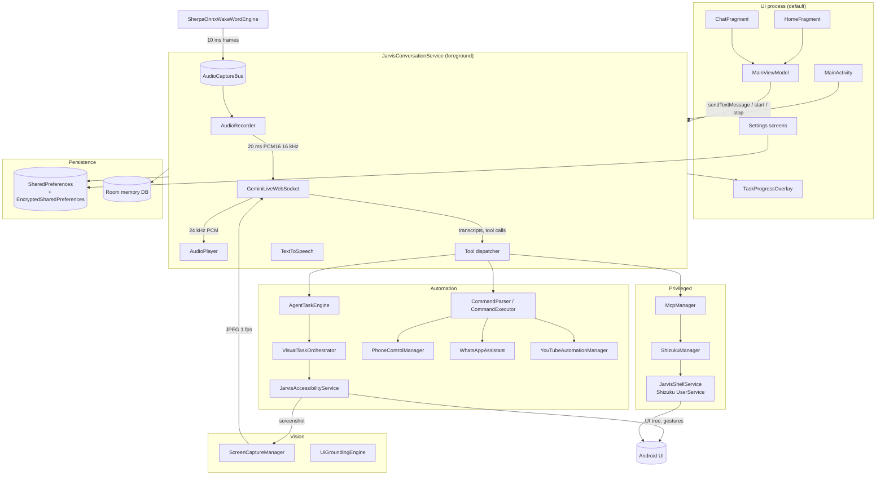

# Architecture Overview

JARVIS is a single-module Android application (`:app`, `com.jarvis.assistant`)
that combines four systems that are usually separate apps:

1. a **real-time voice assistant** over the Gemini Live API (WebSocket, PCM in,
   PCM out),
2. a **screen automation agent** driven by AccessibilityService plus optional
   MediaProjection screen frames,
3. a **privileged device-control layer** through Shizuku, and
4. a **tool platform** that exposes 22 native Gemini functions and 24 built-in
   MCP tools (plus user-added MCP servers).

There is no server component. The only network dependencies are the Gemini
Live endpoint, an optional custom MCP server, the Open-Meteo weather API, and an
optional YouTube Data API key.

## Design principles visible in the code

| Principle | How it is implemented |
| --- | --- |
| The conversation must survive UI death | `JarvisConversationService` is a foreground service that owns mic, player, socket and timers. Activities only observe `StateFlow`s. |
| One microphone owner | `AudioCaptureBus` is a singleton `AudioRecord` shared by the wake-word spotter and the conversation recorder. Wake hand-off keeps the mic open. |
| Model proposes, code verifies | Every UI mutation goes through `AgentTaskEngine` → `SerializedActionExecutor`; results carry `verified` flags and are re-observed. |
| Dangerous actions need a local "yes" | `McpManager` never executes `CONFIRM`/`DANGEROUS` tools without `executeConfirmed()`; the pending action lives in the service with a 2-minute expiry. |
| Degrade without optional privileges | Missing Shizuku, accessibility or overlay permission disables only that capability; voice and chat keep working. |
| Prompt is built from state | `PromptGenerator` + `McpManager.buildPromptContext()` compose the system instruction at session start from preferences, memory and enabled tools. |

## Runtime topology

## Component responsibilities

| Component | File | Responsibility |
| --- | --- | --- |
| App container | `JarvisApp.kt` | Builds and owns the singletons: preferences, chat repository, Room memory, automation managers, Shizuku, MCP. Applies theme on every activity. Tracks foreground state. |
| Conversation service | `background/JarvisConversationService.kt` | The heart of the app. Owns the Live socket, audio pipeline, wake lock, notification, inactivity timer, tool dispatch, MCP confirmation, TTS, and overlay lifecycle. ~3.5k lines. |
| Live transport | `network/GeminiLiveWebSocket.kt` | OkHttp WebSocket for `BidiGenerateContent`. Builds the setup payload and all 22 function declarations, streams audio/video, parses server events, renews the session every 9 minutes, reconnects with exponential backoff, falls back to a second model once. |
| Prompt builder | `util/PromptGenerator.kt` | Composes the persona, language mandate, safety and task-execution rules, device state and memory context into the system instruction. |
| Shared mic | `audio/AudioCaptureBus.kt` | Single `AudioRecord` at 16 kHz mono PCM16, `VOICE_COMMUNICATION` source, platform AEC/NS/AGC. Provides 20 ms frames to listeners, 2 s rolling pre-roll, 3.5 s wake hand-off lease (5 s hard cap). |
| Wake word | `voice/SherpaOnnxWakeWordEngine.kt` | Sherpa-ONNX int8 zipformer keyword spotter on 10 ms slices. Triggers the floating orb/session, pauses itself, and hands the microphone over without a gap. |
| Recorder / player | `audio/AudioRecorder.kt`, `audio/AudioPlayer.kt` | Attach to the bus, emit 20 ms chunks, amplitude/frequency analysis; queue 24 kHz PCM on `AudioTrack`, signal turn completion. |
| Chat UI | `ui/home/*`, `ui/chat/*`, `data/repository/ChatRepository.kt` | Orb, status cards, typed chat, persisted history (max 100 turns), `StateFlow` observation of the service. |
| Memory | `data/memory/*` | Room-backed long-term facts with categories; 30-turn short-term window; keyword extraction from conversation. |
| Automation orchestration | `automation/agent/AgentTaskEngine.kt` | Authoritative task state machine, plan, evidence, cancellation, pause/resume, and the single gate for UI mutations. |
| UI action engine | `vision/VisualTaskOrchestrator.kt` | Resolves and performs click/type/scroll/key actions, waits for UI stability, verifies text entry, inspects the screen tree. |
| Accessibility | `automation/accessibility/JarvisAccessibilityService.kt` | Reads the node tree, dispatches gestures, takes screenshots, and contains app-specific flows for WhatsApp and YouTube. |
| Deterministic commands | `automation/command/*` | Regex/keyword parser and executor used as a fallback when the model does not call a tool, and for local yes/no confirmation handling. |
| Device control | `automation/phone/PhoneControlManager.kt` | Calls, SMS, alarms, volume, brightness, torch, app launch, URLs, web search. |
| App automations | `automation/whatsapp/*`, `automation/youtube/*` | Contact disambiguation, draft/send, calls, message delete; YouTube search/play/subscribe/fullscreen. |
| Vision | `vision/ScreenCaptureManager.kt`, `vision/UiGroundingEngine.kt` | MediaProjection → ImageReader → JPEG at ≤768 px, ~1 fps streaming; element grounding with stable IDs and bounds. |
| MCP | `mcp/*` | Catalogue, risk gate, encrypted custom-server storage, Streamable-HTTP JSON-RPC client, prompt context. |
| Privileged shell | `system/ShizukuManager.kt`, `system/JarvisShellService.kt`, `aidl/IJarvisShellService.aidl` | Shizuku permission/binding and a UserService that runs shell commands with caps. |
| Security | `security/*` | Package-name check, release certificate pin, developer identity constants. |

## State ownership

All conversation state lives in the service's companion object and is exposed
read-only:

| Flow | Type | Meaning |
| --- | --- | --- |
| `isSessionOn` | `StateFlow<Boolean>` | A Live session is active (not necessarily connected). |
| `isStandby` | `StateFlow<Boolean>` | Wake-word standby after `go_to_background` or inactivity. |
| `conversationState` | `StateFlow<ConversationState>` | `IDLE`, `LISTENING`, `THINKING`, `SPEAKING`, … |
| `connectionStatus` | `StateFlow<String>` | Human-readable socket status (`READY`, `CONNECTING`, `LIVE`, errors). |
| `liveError` | `StateFlow<JarvisLiveError?>` | Typed error with code and an action label for the UI. |
| `audioLevel`, `audioFrequency` | `StateFlow` | Drives the orb animation. |
| `liveUserTranscript`, `liveAssistantResponse` | `StateFlow<String>` | Streaming captions. |
| `events`, `wakeEvents` | `SharedFlow` | One-off UI events (toasts, wake acknowledgements). |

The Activity never owns the socket, recorder or player. Removing the app from
Recents does not stop the conversation; `stopWithTask="false"` and the
foreground service keep it alive.

## Threading model

| Work | Thread / dispatcher |
| --- | --- |
| UI | Main thread |
| Audio capture | Dedicated `AudioCaptureBus` worker thread |
| Audio playback | `AudioTrack` write loop on its own thread |
| WebSocket callbacks | OkHttp dispatcher; results are marshalled to coroutines |
| Tool execution | `serviceScope` (`SupervisorJob + Dispatchers.Default`) with `Dispatchers.IO` for blocking work, serialized by `toolExecutionMutex` |
| Screen capture | `HandlerThread("JarvisScreenCaptureThread")` |
| Room / prefs | `Dispatchers.IO` |
| Wake-word inference | `Dispatchers.Default` for model load; inference on the audio bus thread |

## Resilience behaviour

- **Reconnect:** 500 ms → 1 s → 2 s → 4 s → 8 s → 16 s → 30 s cap.
- **Session renewal:** proactive at ~9 minutes to avoid server-side limits.
- **Model fallback:** one switch to `models/gemini-3.8-live` on model-related
  400/404 responses.
- **Audio buffering:** chunks are held until the socket reports `LIVE`, then
  flushed in order.
- **Typed messages:** queued in `pendingTypedText` and re-sent on the next
  `LIVE` transition; never silently dropped.
- **Tool timeouts:** per-tool timeouts (`automationToolTimeoutMs`), 400-step
  ceiling for bulk tasks, hard stop after repeated failures.
- **Wake hand-off:** 2 s pre-roll + up to 3.5 s lease so the first word after
  "Jarvis" is not lost.

## Non-goals

- No cloud backend, account system or telemetry.
- No always-on server-side wake word; wake detection is on-device.
- No Play Integrity or remote attestation; the identity screen reports remote
  verification as unavailable.
- No multi-user support; owner voice verification is optional and local.

## Related documents

- [Module map](module-map.md)
- [Runtime flows](runtime-flows.md)
- [Automation engine](automation-engine.md)
- [Gemini tools](../reference/gemini-tools.md)
- [MCP tools](../reference/mcp-tools.md)
