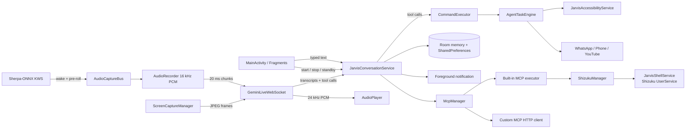

# Jarvis Assistant — Architecture Overview

Jarvis is a single-module Android app (`com.jarvis.assistant`) that combines a
Gemini Live voice/text assistant, on-device wake-word detection, and an
accessibility-driven task automation engine.

## Runtime at a glance

## Main components

| Area | Key classes | Responsibility |
| --- | --- | --- |
| App container | `JarvisApp` | Creates preferences, repositories, memory, automation managers, and the app coroutine scope. |
| Conversation service | `JarvisConversationService` | Foreground service that owns the Live session, audio pipeline, wake lock, notifications, typed-chat queue, and automation dispatch. |
| Gemini transport | `GeminiLiveWebSocket` | OkHttp WebSocket client for `BidiGenerateContent`; setup payload, audio/video frames, transcripts, tool calls, session renewal, reconnect backoff. |
| Audio input | `AudioCaptureBus`, `AudioRecorder`, `AudioUtils`, `HeadsetAudioRouter` | One shared 16 kHz PCM capture owner for Sherpa-ONNX KWS and the conversation pipeline, with AEC/NS/AGC, wake pre-roll hand-off, amplitude/frequency data, and Bluetooth/wired routing. |
| Audio output | `AudioPlayer` | Queues PCM chunks on an `AudioTrack`, drives amplitude callbacks, signals turn completion. |
| Chat UI | `ChatFragment`, `JarvisChatAdapter`, `ChatRepository` | Typed messages, transcript bubbles, history persistence. |
| Home UI | `MainActivity`, `HomeFragment`, `JarvisOrbView` | Navigation, orb, status cards, task fallback panel. |
| Settings | `SettingsActivity` and settings screens | API key/model/voice/persona/theme/permissions configuration. |
| Memory | `MemoryDatabase`, `MemoryRepository`, `MemoryManager` | Local Room-backed facts, short-term turns, owner voice profile metadata. |
| Automation | `CommandExecutor`, `AgentTaskEngine`, `JarvisAccessibilityService` | Tool-call execution, multi-step task planning/verification, UI actions. |
| App automations | `WhatsAppAssistant`, `PhoneControlManager`, `YouTubeAutomationManager` | WhatsApp messaging/calls, phone intents, YouTube search/playback. |
| Vision | `ScreenCaptureManager`, `VisualTaskOrchestrator`, `GroundingEngine` | MediaProjection frame capture, JPEG streaming, on-demand verification snapshots. |
| Security | `SecurityManager`, `AppIdentityVerifier` | Package/signature checks, release certificate pinning. |
| Shizuku | `ShizukuManager`, `JarvisShellService`, `IJarvisShellService` | Permission/binding lifecycle and a privileged UserService shell with capped output and timeouts. |
| MCP | `McpManager`, `BuiltInMcpRegistry`, `BuiltInMcpExecutor`, `McpHttpClient`, `McpPreferences` | Built-in/custom tool catalogue, encrypted custom-server storage, risk gate, HTTP JSON-RPC transport, prompt context. |

## Voice turn lifecycle

1. `MainActivity` starts `JarvisConversationService`; the service acquires a
   partial wake lock and Wi-Fi lock and shows its foreground notification.
2. `AudioRecorder` streams 640-byte (20 ms) PCM chunks. Chunks are buffered until
   the WebSocket reports `LIVE`, then flushed.
3. `GeminiLiveWebSocket` sends `realtimeInput` audio. Assistant audio returns as
   PCM chunks and is queued in `AudioPlayer`.
4. Assistant transcript chunks accumulate in `currentTurnAssistantText`; user
   input transcription accumulates in `currentTurnUserText`.
5. `onTurnCompleted` performs command fallback and memory learning. When audio
   playback finishes (or the session is stopped), `finalizeTurn()` writes one
   chat turn and one short-term memory entry.

## Typed chat path

Typed messages use the same Live session but a separate bookkeeping path:

- `JarvisConversationService.sendTextMessage()` queues text in
  `pendingTypedText`. If the service is still starting, the message is also
  shown immediately through `ChatRepository.beginTurn()`.
- When the socket reaches `LIVE`, `flushTypedMessages()` sends queued messages in
  order. Failed sends remain queued for the next `LIVE` transition.
- Each sent message is tracked in `typedTurnsAwaitingReply`. When its reply is
  finalized, `completeLastTurn()` attaches the reply to the existing user bubble
  instead of creating a duplicate “Spoken user query” turn.
- If no matching bubble exists, the service falls back to `addTurn()` so a reply
  is never lost.

## Session resilience

- `sendClientContent()` returns `false` when the socket is not ready, allowing
  the service to keep messages queued.
- Reconnects use exponential backoff: 500 ms, 1 s, 2 s, 4 s, 8 s, 16 s, capped
  at 30 s. `stopTimers()` cancels pending reconnect work on an explicit stop.
- Sessions are proactively renewed after ~9 minutes. On model-related HTTP
  400/404 failures, the client switches once to `models/gemini-3.8-live`.
- HTTP 400 is no longer treated as “invalid API key”; only explicit key markers
  or 401/403 produce `API_KEY_INVALID`. The real server reason is surfaced.

## Automation path

Gemini tool calls arrive as `onToolCall`. `JarvisConversationService` validates
owner verification, dispatches through `CommandExecutor`, and reports results
back to the Live session. Multi-step tasks run in `AgentTaskEngine`, which asks
`JarvisAccessibilityService` to inspect and act on the current screen, records
step evidence, and requires verification before marking a task complete. A
floating `TaskProgressOverlay` shows progress when the app is in the background;
`HomeFragment` shows an in-app fallback when overlay permission is unavailable.

## Shizuku and MCP path

The user enables individual built-in MCP servers or adds a custom Streamable
HTTP MCP endpoint in settings. `McpManager.buildPromptContext()` injects only the
enabled tool catalogue into the Gemini system prompt. Gemini calls the generic
`execute_mcp_tool` function; `McpManager` re-resolves the exact tool, validates
arguments, checks Shizuku permission when required, and blocks every non-SAFE
tool behind a local confirmation.

Built-in tools execute in-process or through `ShizukuManager`. Shizuku binds
`JarvisShellService` as a UserService in its privileged process; the AIDL
contract exposes `runCommand` and the reserved `destroy` transaction. Custom
tools use `McpHttpClient` (`initialize`, `notifications/initialized`,
`tools/list`, `tools/call`) with JSON/SSE response parsing and no automatic
redirects.

A pending confirmation is held in `JarvisConversationService` with a two-minute
expiry. Only the local yes/no command path calls `executeConfirmed()`; a new
tool call cannot replace a different pending action, and unrelated speech or a
stop command clears it.

## Vision path

`ScreenCaptureManager` obtains a `MediaProjection`, mirrors the display into an
`ImageReader`, converts frames to JPEG, and forwards them to Gemini. Streaming is
throttled; high-resolution snapshots are produced on demand. Bitmap access and
compression are guarded by `bitmapLock`.

## Persistence and configuration

- Room (`MemoryDatabase`) stores long-term memory; `MemoryManager` combines it
  with recent turns.
- `AppPreferences` stores settings in `SharedPreferences`. The Gemini API key is
  stored in `EncryptedSharedPreferences` when available, with a guarded
  plaintext fallback on devices where the Android Keystore cannot initialise.
- Chat history is persisted by `ChatRepository` and exposed as a `StateFlow`.

## Related documents

- [Module map](module-map.md)
- [Build and setup](../setup/build.md)
- [Permissions and security](../security/permissions-and-security.md)
- [Bug-fix log](../maintenance/bugfix-log.md)
- [Voice architecture research](voice-architecture-research.md)
