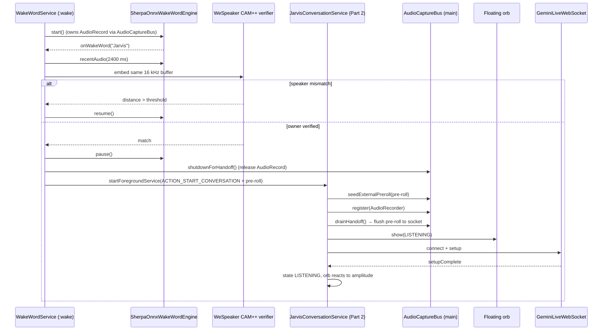
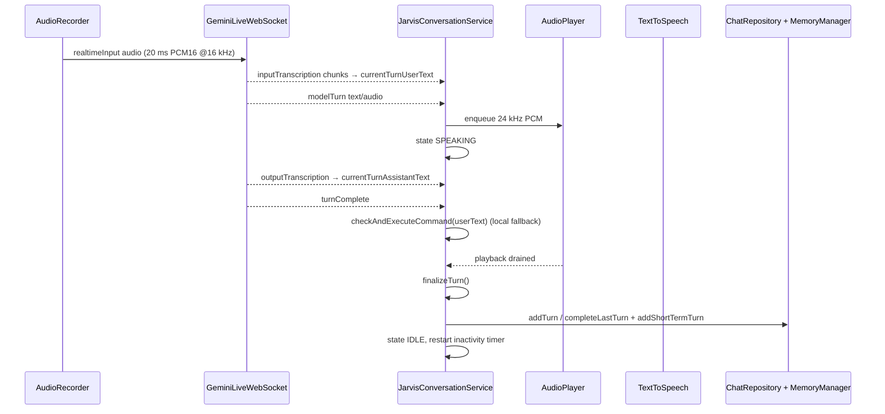
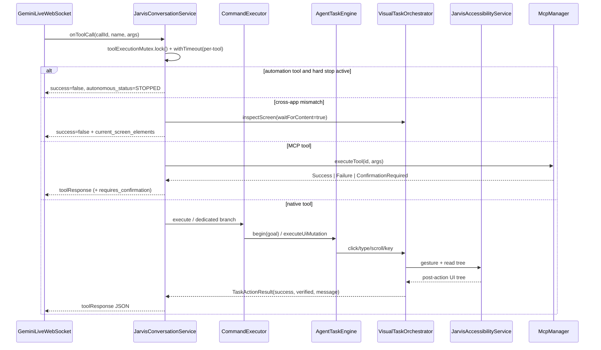
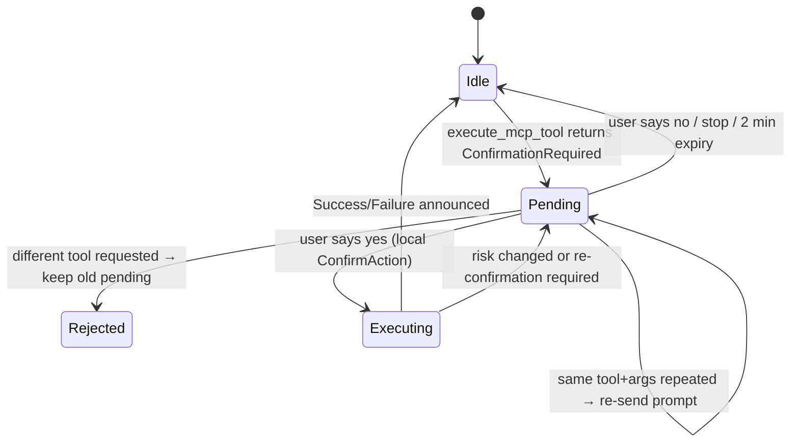

# Runtime Flows

This document traces the concrete code paths for the six flows that matter most.
Line numbers refer to the current sources and may drift; class and method names
are the stable reference.

## 1. Wake word → conversation start

Part 1 (`:wake`) is the always-on microphone owner. Part 2 (main process) is
started only after the keyword **and** the owner voice match succeed; it shows
the floating orb instead of opening `MainActivity`.



Key details:

- `WakeWordService` runs in the `:wake` process declared in the manifest. That
  process initialises only `JarvisApp.instance` and a lightweight
  `AppPreferences`; Room, TTS, Gemini, MCP, Shizuku, backup and the 68 MB Vosk
  ASR model are never loaded there.
- `AudioCaptureBus.register()` starts the single `AudioRecord`; it is reference
  counted by listeners plus the hand-off lease.
- The keyword spotter keeps a recent-PCM ring buffer. Owner verification runs
  once on the **same** buffer that produced "Jarvis" — there is no second
  verification phrase.
- New enrollments store a WeSpeaker CAM++ profile. Existing Vosk x-vector
  profiles still work as a fallback, and `:wake` loads only the 15 MB speaker
  model for them, never the ASR model.
- On a mismatch the service simply resumes listening; Part 2 is not started.
- On a match Part 1 pauses the spotter and releases the microphone before
  starting Part 2. The recent PCM travels in `EXTRA_WAKE_PREROLL`, and Part 2
  seeds `AudioCaptureBus` before `AudioRecorder` attaches, so the command onset
  is preserved across processes.
- Part 2 never opens `MainActivity`. It attaches the bottom-centre orb, which
  breathes while silent and reacts to mic RMS and TTS amplitude.
- When the session ends (inactivity, `go_to_background`, orb long-press or
  full stop), Part 2 calls `ACTION_RESUME_AFTER_SESSION`; Part 1 waits 700 ms
  for the recorder to close, then reattaches the keyword spotter.
- System-assistant/assist gestures use `JarvisVoiceInteractionService`, which
  pauses Part 1 for the session and resumes it afterwards. It does not run a
  duplicate wake listener while Part 1 is the active owner.
- If Part 1 is disabled or not running, Part 2 falls back to its legacy
  in-process standby spotter.

## 2. Voice turn lifecycle



Details:

- `hasSpeechInCurrentUtterance`, `consecutiveVoicedFrames` and
  `totalVoicedFramesInCurrentUtterance` implement a local end-of-speech detector;
  `sendAudioStreamEnd()` is sent when the local VAD decides the user stopped, so
  Gemini does not wait for its slower server timeout.
- Owner voice verification is evaluated mid-utterance (around frame 15) and
  again before finalising. If enabled and not verified, the turn is not written
  to history and local commands are blocked.
- `finalizeTurn()` is the single writer of a completed turn. It attaches a
  typed reply to the existing typed bubble when the transcripts match, otherwise
  it appends a new turn.
- Assistant speech is also scanned for embedded commands
  (`checkAssistantTextForCommands`) so a model sentence such as "opening
  YouTube" can trigger the deterministic path when the tool call was missed.

## 3. Typed chat

```
ChatFragment → MainViewModel → JarvisConversationService.sendTextMessage(text)
    ├─ service null → ChatRepository.beginTurn(text) + pendingTypedText.addLast
    └─ service alive → submitTypedMessage(text)
                        ├─ socket not LIVE → pendingTypedText.addLast
                        └─ LIVE → sendClientContent + typedTurnsAwaitingReply.add
```

- `flushTypedMessages()` runs on every `LIVE` transition and drains the queue in
  order. A failed `sendClientContent()` returns `false` and the message stays
  queued.
- `finalizeTurn()` consumes the head of `typedTurnsAwaitingReply` only when the
  voice transcript is empty or equals the typed text, so a voice reply cannot
  steal a typed bubble.
- History is capped at 100 turns in `ChatRepository`.

## 4. Tool call execution



Guard rails in `handleToolCallExecution()`:

| Guard | Behaviour |
| --- | --- |
| `toolExecutionMutex` | One tool at a time. |
| `withTimeout(automationToolTimeoutMs(name))` | Per-tool deadline. |
| `autonomousHardStop` | Refuses further automation after repeated failures; tells the model to stop. |
| `expectedPackageForTask()` | Blocks `click/type/scroll/press` when the foreground package does not match the task's expected app. |
| Step ceiling | `MAX_AUTONOMOUS_STEPS` (400 for Instagram bulk tasks). |
| Cancellation | `cancelAllActiveTools()` cancels the job, the agent task and pending actions. |

Every automation result is expected to carry `success` and, where relevant,
`verified` plus `current_screen_elements`. The model is instructed not to claim
success without it.

## 5. MCP confirmation



- The pending action is stored only in `JarvisConversationService`
  (`pendingMcpAction`) and expires after 2 minutes.
- `McpManager.executeTool()` returns `ConfirmationRequired` for every non-`SAFE`
  tool; nothing is executed.
- Only `checkAndExecuteCommand()` → `ConfirmAction` → `executeConfirmed()` can
  execute it. The local command path has priority over WhatsApp/generic pending
  confirmations.
- If a tool's risk was `SAFE` when queued and became non-`SAFE`, execution is
  refused and re-confirmation is required.

## 6. Screen sharing and vision

```
MainActivity → MediaProjection consent → JarvisConversationService.startScreenCapture()
    → ScreenCaptureManager.startCapture(projection, metrics, onFrame)
        → VirtualDisplay + ImageReader (≤768 px, even dimensions)
        → JPEG every ~1 s (minFrameIntervalMs = 1000)
        → liveWebSocket.sendMediaChunk(jpeg)
```

- Screen capture is opt-in and requires a live socket; the service refuses to
  start capture when the session is not `LIVE`.
- `ScreenCaptureManager` keeps the latest `Bitmap` guarded by `bitmapLock` for
  on-demand verification snapshots (`captureScreenJpeg`).
- `JarvisAccessibilityService.captureScreenJpeg()` uses the accessibility
  screenshot API as a fallback when MediaProjection is not active.
- `canSendVideoFrame()` is checked per frame to avoid sending after stop.
- Demotion (`demoteFromMediaProjection()`) changes the foreground service type
  back when sharing stops, so the persistent notification is accurate.

## 7. Session lifecycle, renewal and recovery

| Event | Handling |
| --- | --- |
| Socket closed unexpectedly | `scheduleReconnect()` with backoff 0.5→30 s. |
| Setup never completes | Connection state error, reconnect scheduled. |
| Model 400/404 | `fallbackModelIfPossible()` switches once to `models/gemini-3.8-live`. |
| 9 minutes elapsed | `startSessionRenewal()` disconnects and reconnects proactively. |
| User stops | `stopActiveConversation()` cancels timers, tools, pending MCP action, resets agent, releases audio. |
| Inactivity | 30 minutes → `enterStandby()` → wake-word listening. |
| App in background | Foreground service + `stopWithTask=false`; overlay shows progress. |
| Screen off | Partial wake lock keeps the session; Wi-Fi lock keeps the socket. |

## Timing constants

| Constant | Value | Location |
| --- | --- | --- |
| Audio chunk | 20 ms / 640 B | `AudioCaptureBus.CHUNK_SIZE_BYTES` |
| Wake slice | 10 ms / 320 B | `AudioCaptureBus.WAKE_CHUNK_SIZE_BYTES` |
| Wake pre-roll | 2 s | `MAX_RECENT_FRAMES` |
| Wake hand-off | 3.5 s | `HANDOFF_TIMEOUT_MS`, `HANDOFF_MS` |
| Wake cooldown | 1.5 s | `COOLDOWN_MS` |
| Inactivity → standby | 30 min | `INACTIVITY_TIMEOUT_MS` |
| Session renewal | 9 min | `SESSION_RENEWAL_MS` |
| MCP confirmation TTL | 2 min | `McpPendingAction` |
| Screen frame interval | 1 s | `minFrameIntervalMs` |
| Max autonomous steps | 25 default, 400 for Instagram bulk tasks | `MAX_AUTONOMOUS_STEPS`, `autonomousTaskStepLimit()` |
| Chat history | 100 turns | `ChatRepository` |
| Short-term memory | 30 turns | `MemoryManager.MAX_SHORT_TERM_TURNS` |
